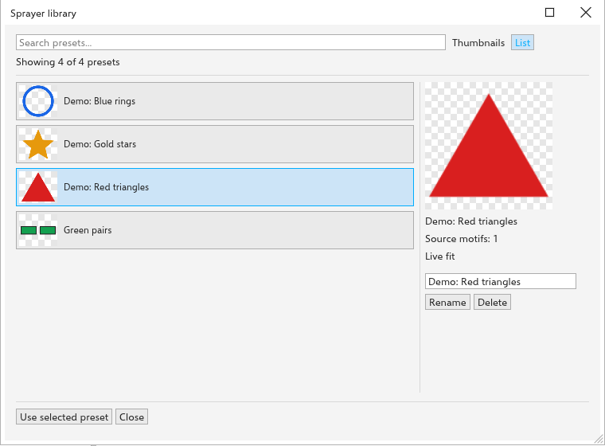

# Reusable sprayer demo



The screenshot shows the tested local library prototype with original
synthetic motifs; no imported drawing data is included.

`sprayer-demo.tdraw` contains only original synthetic geometry: a pair of
green rectangles grouped as one motif near the bottom of the page, a
straight live fit in the middle and a spare curved guide above it.

Open the drawing and Object > Fit Objects to Path, then scroll below the
placement controls and expand Sprayer presets. Select the straight
fit's guide or a placed group, enter a preset name and click Save new.
Select the spare curve, open Browse library, choose the preset and click
Use selected preset, then Apply preset to path.
Reshape the curve and check that only its own fit follows. Undo removes
the applied stroke in one step. Restart and reuse the saved preset in a
new drawing. Library deletion leaves the placed artwork intact.

Regenerate a local copy and example preferences with the focused helper:

```sh
TRACEDRAW_SPRAYER_DEMO=/tmp/sprayer-demo cargo test -p tracedraw --lib \
  sprayer_write_local_demo -- --ignored
```

The helper writes only to the explicit directory; it does not install
preferences or alter other drawings. No imported artwork is bundled.
